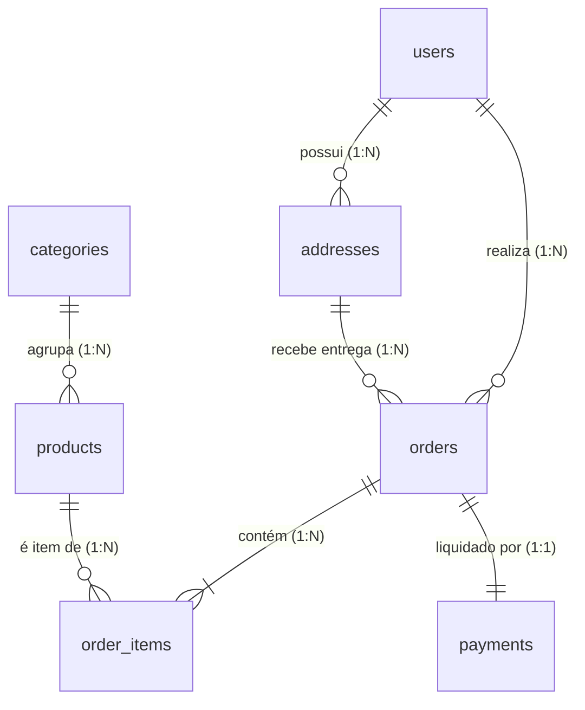

# 🛒 E-Commerce Fullstack (Portfólio de Alta Performance)

Uma plataforma completa de comércio eletrônico desenvolvida com foco em integridade transacional de dados, escalabilidade, checkout transparente (Pix e Cartão de Crédito) e arquitetura moderna em monorepo.

---

## 🚀 Tecnologias Utilizadas

* **Backend**: Node.js, TypeScript, Fastify, Prisma ORM, JWT (Access & Refresh Tokens), Bcrypt.
* **Frontend**: Next.js (App Router), React, TypeScript, Tailwind CSS, Lucide Icons.
* **Banco de Dados**: PostgreSQL (Supabase / Neon) com modelagem relacional estrita (UUIDs, Snapshots imutáveis, restrições e índices de performance).
* **Integrações de Pagamento & Logística**: Mercado Pago SDK/API (Pix dinâmico e Cartão de Crédito em Sandbox), Webhooks e ViaCEP.

---

## 📂 Estrutura do Repositório (Monorepo)

```
E-commerce/
├── docs/                     # Documentação de arquitetura, banco e telas
│   ├── architecture/
│   │   ├── system-architecture.md   # Topologia da solução e segurança
│   │   ├── state-machine.md         # Máquinas de estado de pedidos e pagamentos
│   │   └── user-flows.md            # Diagramas dos fluxos de cliente e admin
│   ├── database/
│   │   ├── schema.sql               # Script DDL completo para PostgreSQL
│   │   ├── erd.md                   # Diagrama ERD visual (Mermaid)
│   │   └── data-dictionary.md       # Dicionário de dados de todas as tabelas
│   └── wireframes/
│       └── screen-specs.md          # Especificação de interfaces e fluxos UX
├── server/                   # Backend API REST (Fastify + Prisma)
├── client/                   # Frontend Web (Next.js + Tailwind)
├── .gitignore
├── README.md
├── CHANGELOG.md
├── CONTRIBUTING.md
└── .env.example
```

---

## 🗄️ Modelo de Dados Relacional (DER)

O banco de dados relacional é estruturado sobre 7 entidades principais, assegurando integridade contábil através do **Price Snapshot Pattern**:



*Consulte a documentação completa do banco de dados em [docs/database/erd.md](docs/database/erd.md) e o script SQL em [docs/database/schema.sql](docs/database/schema.sql).*

---

## 🗺️ Roadmap de Desenvolvimento

- [x] **Etapa 1: Planejamento e Arquitetura de Dados**
  - [x] Definição de escopo do MVP e regras de negócio.
  - [x] Modelagem de dados relacional completa (DER e DDL SQL).
  - [x] Máquina de estados para pedidos e pagamentos com controle transacional de estoque.
  - [x] Mapeamento dos fluxos de navegação e wireframes estruturais de telas.
- [x] **Etapa 2: Desenvolvimento do Backend (API REST)**
  - [x] Configuração do servidor Fastify com TypeScript e Prisma ORM.
  - [x] Autenticação com JWT, refresh tokens e hash de senhas.
  - [x] CRUD de categorias e produtos com filtros de busca.
  - [x] Gestão transacional de pedidos e reserva atômica de estoque.
  - [x] Documentação interativa Swagger/OpenAPI em `/docs`.
- [x] **Etapa 3: Integrações de Serviços (Modo Sandbox)**
  - [x] Gateway Mercado Pago: Geração de Pix dinâmico (QR Code e Copia e Cola) e Cartão de Crédito com tokenização.
  - [x] Webhooks Assíncronos: Endpoint com garantia de idempotência e cancelamento/estorno de estoque.
  - [x] Logística e Frete: Integração com ViaCEP e cálculo dinâmico de PAC e Sedex por peso e cubagem.
- [x] **Etapa 4: Desenvolvimento do Frontend**
  - [x] Catálogo com busca e filtros reativos.
  - [x] Carrinho de compras responsivo com persistência local.
  - [x] Checkout transparente com validação de campos em tempo real.
  - [x] Painel do cliente com histórico de pedidos.
- [x] **Etapa 5: Painel Administrativo (Backoffice)**
  - [x] Proteção de rotas administrativas via RBAC (`role = 'admin'`).
  - [x] Gestão de produtos (preços, estoque e imagens).
  - [x] Atualização de status e inserção de código de rastreamento.
- [x] **Etapa 6: Deploy e Documentação Final**
  - [x] Guia de execução local e credenciais de teste para recrutadores.

---

## 📊 Status das Páginas Frontend

| Página | Rota | Status |
|--------|------|--------|
| Home | `/` | ✅ |
| Detalhes do Produto | `/product/[slug]` | ✅ |
| Carrinho | `/cart` | ✅ |
| Checkout | `/checkout` | ✅ |
| Pagamento Pix | `/checkout/pix` | ✅ |
| Pagamento Cartão | `/checkout/card` | ✅ |
| Login | `/login` | ✅ |
| Cadastro | `/register` | ✅ |
| Meus Pedidos | `/orders` | ✅ |
| Detalhes do Pedido | `/order/[id]` | ✅ |
| Perfil do Usuário | `/profile` | ✅ |
| Página de Categoria | `/category/[slug]` | ✅ |
| Painel Admin (Dashboard) | `/admin` | ✅ |
| Admin - Pedidos | `/admin/orders` | ✅ |
| Admin - Produtos | `/admin/products` | ✅ |
| Admin - Categorias | `/admin/categories` | ✅ |
| Página de Sucesso | `/success` | ✅ |

---

## 🧪 Credenciais de Teste

**Admin:**
- Email: `admin@ecommerce.com`
- Senha: `admin123`

**Cliente:**
- Email: `cliente@teste.com`
- Senha: `cliente123`

---

## 🚀 Como Executar Localmente

O projeto possui scripts prontos no `package.json`:

```bash
# Backend
npm run dev      # Desenvolvimento (tsx watch)
npm run build    # Compilar TypeScript
npm run start    # Executar servidor

# Frontend  
npm run dev      # Next.js dev server

# Banco
npm run prisma:migrate  # Migrações
npm run prisma:seed     # Dados iniciais
```

---

## 📖 Documentação Adicional

- [Arquitetura do Sistema](/docs/architecture/system-architecture.md) - Diagramas e fluxos
- [Modelo de Dados](/docs/database/) - Schema e dicionário
- [Fluxos de Usuário](/docs/architecture/user-flows.md) - Jornadas completas
- [Client README](/client/README.md) - Guia do frontend