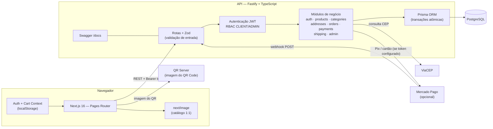
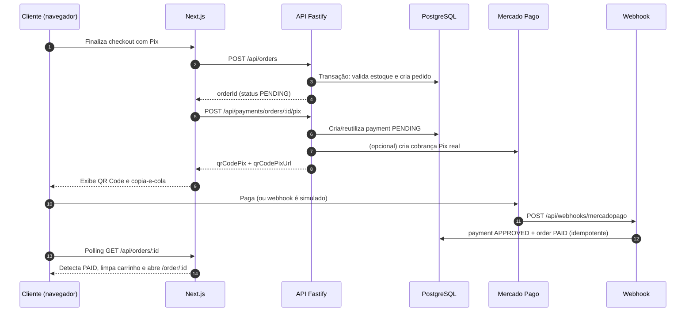
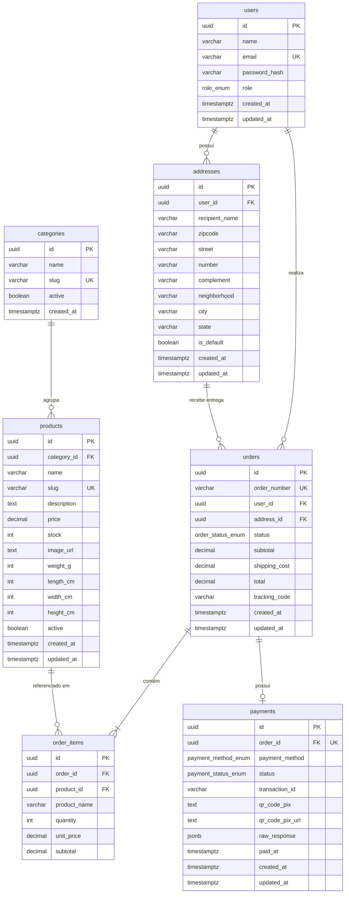

# 🛒 TechStore — E-commerce Fullstack

Plataforma completa de e-commerce com catálogo, carrinho, checkout transparente (Pix e cartão), painel administrativo, controle de estoque transacional e rastreamento de pedidos.

O projeto foi construído como um **monorepo** com API REST em **Fastify + Prisma + PostgreSQL** e frontend em **Next.js 16 (Pages Router) + React 19 + Tailwind CSS 4**.

[](https://nextjs.org/)
[](https://react.dev/)
[](https://www.typescriptlang.org/)
[](https://fastify.dev/)
[](https://www.prisma.io/)
[](https://www.postgresql.org/)
[](#-licença)

> **Demonstração:** o projeto está pronto para deploy (blueprint do Render e configuração da Vercel incluídos), mas não possui uma URL pública publicada neste repositório. O modo de pagamento padrão é **simulado**, para que qualquer pessoa consiga percorrer o fluxo completo sem chaves de gateway.

---

## 📑 Sumário

- [Visão geral](#-visão-geral)
- [Funcionalidades](#-funcionalidades)
- [Stack tecnológica](#-stack-tecnológica)
- [Arquitetura](#-arquitetura)
- [Estrutura do repositório](#-estrutura-do-repositório)
- [Modelo de dados (DER)](#-modelo-de-dados-der)
- [Rodando localmente](#-rodando-localmente)
- [Credenciais de teste](#-credenciais-de-teste)
- [Pagamentos, Pix e webhooks](#-pagamentos-pix-e-webhooks)
- [Deploy](#-deploy)
- [API — endpoints principais](#-api--endpoints-principais)
- [Testes e validações executadas](#-testes-e-validações-executadas)
- [Limitações conhecidas](#-limitações-conhecidas)
- [Licença](#-licença)

---

## 🎯 Visão geral

A TechStore simula uma loja de tecnologia de ponta a ponta:

1. O visitante navega pelo catálogo, filtra por categoria/preço, busca por nome e ordena resultados.
2. Adiciona produtos ao carrinho (persistido em `localStorage`).
3. Autentica-se com JWT e cadastra um endereço com autocomplete de CEP (ViaCEP).
4. Escolhe frete PAC ou SEDEX (cotação simulada por UF, peso e dimensões).
5. Finaliza o pedido com **reserva atômica de estoque**.
6. Paga com **Pix** (QR Code + copia-e-cola) ou **cartão de crédito**.
7. O pagamento é confirmado por **webhook**, o pedido muda para `PAID` e o carrinho é limpo.
8. O administrador acompanha indicadores, gerencia catálogo/estoque e atualiza o pedido para `SHIPPED`/`DELIVERED` com código de rastreio — ou cancela, devolvendo o estoque.

---

## ✨ Funcionalidades

### Loja (cliente)

- Catálogo com busca, filtro por categoria, faixa de preço, ordenação e paginação.
- Página de produto com imagem 1:1, descrição, preço, estoque e quantidade.
- Carrinho persistente, alteração de quantidade e remoção de itens.
- Cadastro/login com access token (15 min) + refresh token (7 dias) e renovação automática.
- Perfil com dados da conta e endereços.
- Checkout com:
  - seleção ou cadastro de endereço;
  - autocomplete de CEP via ViaCEP;
  - cotação de frete PAC/SEDEX com prazo e valor;
  - resumo de subtotal, frete e total.
- Pedidos: histórico e detalhes com status, itens, endereço, pagamento e rastreio.
- Pagamento Pix com QR Code, código copia-e-cola, contador e **polling automático** até a confirmação.
- Pagamento com cartão em ambiente de demonstração (aprovação automática).

### Administração

- Dashboard com receita confirmada, pedidos por status, ticket médio, a receber, produtos ativos, estoque baixo/esgotado, clientes, categorias, gráfico dos últimos 7 dias e pedidos recentes.
- CRUD de produtos (criar, editar preço/estoque/dimensões, ativar/desativar, soft delete).
- Cadastro e listagem de categorias.
- Listagem de todos os pedidos com busca, filtro por status e paginação.
- Atualização de status (`PENDING`, `PAID`, `SHIPPED`, `DELIVERED`, `CANCELED`) e código de rastreio.
- Cancelamento com **reposição automática de estoque**.

### Qualidade e segurança

- Validação de entrada com **Zod** em todas as rotas.
- Senhas com **bcrypt** (custo 10).
- RBAC (`CLIENT` / `ADMIN`) e checagem de propriedade do pedido/endereço.
- Transações Prisma para criação de pedido, baixa de estoque e confirmação/cancelamento de pagamento.
- Idempotência de webhook para pagamentos já aprovados.
- Soft delete de produtos para preservar histórico de pedidos.
- Swagger/OpenAPI em `/docs`.
- CORS configurado para desenvolvimento e produção.

---

## 🧰 Stack tecnológica

| Camada | Tecnologias |
| :--- | :--- |
| **Frontend** | Next.js 16.4 (Pages Router), React 19.3, TypeScript, Tailwind CSS 4, Lucide Icons |
| **Backend** | Node.js, TypeScript, Fastify 4, Zod, JWT (`@fastify/jwt`), Bcrypt |
| **Banco de dados** | PostgreSQL 16 + Prisma ORM 5 |
| **Pagamentos** | Mercado Pago (Pix e cartão) — modo simulado por padrão; webhook de confirmação |
| **Logística** | ViaCEP (autocomplete) + cálculo simulado de PAC/SEDEX |
| **Infra** | Render (API) + Vercel (frontend) + Neon/Supabase (PostgreSQL) — configurações incluídas |
| **Ferramentas** | ESLint 9, TypeScript 5, Swagger UI, tsx |

---

## 🏗 Arquitetura

A aplicação segue uma separação clara entre SPA/SSR do frontend e API REST stateless. O navegador nunca acessa o banco: todas as regras passam pela API.



### Camadas do backend

| Camada | Responsabilidade |
| :--- | :--- |
| `*.routes.ts` | Define endpoints, schemas Zod e middlewares de autenticação/RBAC. |
| `*.controller.ts` | Extrai `params`, `query` e `body`, chama o serviço e formata a resposta HTTP. |
| `*.service.ts` | Regras de negócio: credenciais, pagamentos, gateway. |
| Controllers de catálogo/pedidos | Consultas e transações Prisma (estoque, totais, status). |
| `middlewares/` | `authenticate` (JWT) e `requireRole` (RBAC). |
| `lib/prisma.ts` | Instância única do Prisma Client. |

### Fluxo de pagamento Pix (ponta a ponta)



---

## 📂 Estrutura do repositório

```text
E-commerce/
├── client/                       # Frontend Next.js 16 (Pages Router)
│   ├── components/               # Header, Footer, ProductCard, componentes do admin
│   ├── context/                  # AuthContext e CartContext
│   ├── lib/                      # Cliente HTTP, formatadores e labels
│   ├── pages/                    # Rotas (catálogo, produto, carrinho, checkout, admin...)
│   │   ├── admin/                # Dashboard, pedidos, produtos e categorias
│   │   ├── checkout/             # Pix e cartão
│   │   └── api/health.ts         # Health check do frontend
│   ├── styles/                   # Tailwind CSS 4
│   ├── types/                    # Tipos compartilhados
│   ├── next.config.ts            # Domínios de imagem e turbopack root
│   ├── vercel.json               # Configuração de deploy
│   └── .env.example
├── server/                       # API Fastify + Prisma
│   ├── prisma/
│   │   ├── schema.prisma         # Modelo relacional
│   │   └── seed.ts               # Usuários, endereço, categorias e produtos demo
│   ├── src/
│   │   ├── config/env.ts         # Validação das variáveis de ambiente
│   │   ├── lib/prisma.ts
│   │   ├── middlewares/          # authenticate, requireRole
│   │   ├── modules/              # auth, addresses, products, categories,
│   │   │                         # orders, payments, shipping, admin
│   │   ├── routes.ts             # Registro das rotas
│   │   └── server.ts             # Bootstrap (CORS, JWT, Swagger)
│   └── package.json
├── docs/                         # Arquitetura, DER, dicionário de dados e wireframes
├── render.yaml                   # Blueprint de deploy da API no Render
├── .env.example                  # Template do backend
└── README.md
```

---

## 🗃 Modelo de dados (DER)

Banco PostgreSQL modelado com UUIDs, `snake_case`, enums nativos, timestamps com timezone e integridade referencial.



### Enums

| Enum | Valores |
| :--- | :--- |
| `role_enum` | `client`, `admin` |
| `order_status_enum` | `pending`, `paid`, `shipped`, `delivered`, `canceled` |
| `payment_method_enum` | `pix`, `credit_card` |
| `payment_status_enum` | `pending`, `approved`, `rejected`, `refunded` |

### Decisões de modelagem

- **Snapshot do produto no pedido:** `order_items.product_name` e `unit_price` preservam o histórico mesmo se o produto mudar de preço/nome.
- **Estoque transacional:** a criação do pedido roda em `prisma.$transaction`, valida e debita o estoque atomicamente.
- **Cancelamento repõe estoque:** webhook `rejected`/`cancelled` e cancelamento pelo admin incrementam o estoque dos itens.
- **Soft delete:** `DELETE /api/products/:id` apenas define `active = false`; pedidos históricos continuam íntegros (`ON DELETE RESTRICT`).
- **1:1 pedido/pagamento:** cada pedido possui no máximo um registro de pagamento ativo, reutilizado enquanto estiver pendente.
- **Idempotência:** reenvio de webhook aprovado não duplica efeitos nem altera estoque novamente.

> Documentação complementar: [`docs/database/erd.md`](docs/database/erd.md), [`docs/database/data-dictionary.md`](docs/database/data-dictionary.md) e [`docs/architecture/system-architecture.md`](docs/architecture/system-architecture.md).

---

## 🚀 Rodando localmente

### Pré-requisitos

- **Node.js 20+** e npm
- **PostgreSQL 14+** local **ou** um banco na nuvem (Neon, Supabase, Render)
- Git

### 1. Clone o repositório

```bash
git clone https://github.com/BernMaximo/E-commerce.git
cd E-commerce
```

### 2. Banco de dados

Crie um banco vazio, por exemplo:

```sql
CREATE DATABASE ecommerce;
```

Se preferir um banco gerenciado, crie um projeto no [Neon](https://neon.tech/) ou [Supabase](https://supabase.com/) e copie a connection string.

### 3. API (backend)

```bash
cd server
npm install

# Copie o template e edite DATABASE_URL e JWT_SECRET
cp ../.env.example .env        # Windows: copy ..\.env.example .env

npx prisma generate
npx prisma db push             # cria as tabelas a partir do schema
npm run prisma:seed            # popula usuários, endereço, categorias e produtos demo

npm run dev                    # http://localhost:3333
```

Conferindo:

```bash
curl http://localhost:3333/health
# {"status":"ok","timestamp":"..."}
```

- Swagger UI: **http://localhost:3333/docs**
- A API escuta em `0.0.0.0:$PORT` (padrão `3333`), pronta para containers/PaaS.

Variáveis do backend (`server/.env`):

| Variável | Obrigatória | Descrição |
| :--- | :---: | :--- |
| `NODE_ENV` | não | `development`, `test` ou `production`. |
| `PORT` | não | Porta HTTP (padrão `3333`). |
| `JWT_SECRET` | **sim** | Segredo dos JWT, mínimo 16 caracteres. |
| `DATABASE_URL` | **sim** | Connection string PostgreSQL. |
| `MERCADOPAGO_ACCESS_TOKEN` | não | Sem ele, o app opera em **modo simulação**. |

### 4. Frontend

```bash
cd client
npm install

cp .env.example .env.local     # Windows: copy .env.example .env.local

npm run dev                    # http://localhost:3000
```

`client/.env.local`:

```env
NEXT_PUBLIC_API_URL=http://localhost:3333
```

### 5. Build de produção (opcional)

```bash
# API
cd server
npm run build
npm start

# Frontend
cd client
npm run build
npm start -- -p 3000
```

### Scripts úteis

| Onde | Comando | O que faz |
| :--- | :--- | :--- |
| `server` | `npm run dev` | API com hot reload (`tsx watch`). |
| `server` | `npm run build` / `npm start` | Compila TypeScript e roda `dist/server.js`. |
| `server` | `npx prisma db push` / `npm run prisma:push` | Sincroniza o schema com o banco (sem migrations). |
| `server` | `npm run prisma:seed` | Popula/atualiza os dados de demonstração. |
| `client` | `npm run dev` | Next.js em modo desenvolvimento (Turbopack). |
| `client` | `npm run build` / `npm start` | Build e servidor de produção. |
| `client` | `npm run lint` | ESLint (0 erros). |

---

## 🔑 Credenciais de teste

Criadas pelo `npm run prisma:seed`:

| Perfil | E-mail | Senha | Acesso |
| :--- | :--- | :--- | :--- |
| **Administrador** | `admin@ecommerce.com` | `admin123` | Dashboard, produtos, categorias e todos os pedidos. |
| **Cliente** | `cliente@teste.com` | `cliente123` | Catálogo, carrinho, checkout, pedidos e perfil. |

O cliente já vem com um endereço padrão:

```text
Cliente Demonstração
Praça da Sé, 100 — Apto 42
Sé, São Paulo — SP — CEP 01001-000
```

> ⚠️ Em produção, troque essas senhas ou remova os usuários de demonstração do seed.

---

## 💳 Pagamentos, Pix e webhooks

### Modo simulação (padrão)

Sem `MERCADOPAGO_ACCESS_TOKEN`, a aplicação **não chama o gateway**:

- O Pix gera um código copia-e-cola no padrão EMV e uma imagem de QR Code.
- O cartão é **sempre aprovado** após o envio do formulário.
- O webhook aceita notificações simuladas com `external_reference` e `status`.

Assim, recrutadores e avaliadores conseguem testar o fluxo completo sem credenciais.

### Como simular a confirmação de um Pix

1. Faça um pedido com Pix e abra a página `/checkout/pix?orderId=...`.
2. Copie o `orderId` da URL.
3. Envie o webhook:

**PowerShell (Windows):**

```powershell
$orderId = "COLE-O-ORDER-ID-AQUI"

$body = @{
  type               = "payment"
  data               = @{ id = "test-$([guid]::NewGuid())" }
  external_reference = $orderId
  status             = "approved"
} | ConvertTo-Json -Depth 5

Invoke-RestMethod -Method Post `
  -Uri http://localhost:3333/api/webhooks/mercadopago `
  -ContentType "application/json" `
  -Body $body
```

**cURL (Linux/macOS/Git Bash):**

```bash
curl -X POST http://localhost:3333/api/webhooks/mercadopago \
  -H "Content-Type: application/json" \
  -d '{
    "type": "payment",
    "data": { "id": "test-1" },
    "external_reference": "COLE-O-ORDER-ID-AQUI",
    "status": "approved"
  }'
```

Em até 3 segundos a página detecta `PAID`, limpa o carrinho e redireciona para `/order/:id`.

Para testar recusa e reposição de estoque, use `"status": "rejected"` — o pedido vira `CANCELED` e o estoque é devolvido.

### Modo real (Mercado Pago)

Defina `MERCADOPAGO_ACCESS_TOKEN` (sandbox ou produção). A API passa a:

- criar cobranças Pix reais em `/v1/payments`;
- consultar o pagamento real no webhook usando `data.id`;
- aprovar/recusar o cartão conforme o gateway.

> **Importante:** o frontend atual **não tokeniza cartão** (envia um token de simulação). Para cartão em modo real é necessário integrar o SDK/Checkout Bricks do Mercado Pago no cliente. O fluxo Pix real já está implementado no backend.

### Cartões de teste do Mercado Pago (sandbox)

Usados quando a tokenização real for integrada. Em modo simulação, **qualquer dado é aceito**.

| Bandeira | Número | CVV | Validade |
| :--- | :--- | :--- | :--- |
| Mastercard | `5031 4332 1540 6351` | `123` | `11/30` |
| Visa | `4235 6477 2804 9999` | `123` | `11/30` |
| Amex | `3757 781744 61804` | `1234` | `11/30` |

CPF de teste sugerido: `123.456.789-09`.

---

## ☁️ Deploy

A arquitetura recomendada para portfólio é **Neon (PostgreSQL) + Render (API) + Vercel (frontend)**, todos com plano gratuito.

### 1. Banco — Neon ou Supabase

1. Crie um projeto no [Neon](https://neon.tech/).
2. Copie a connection string (`postgresql://...neon.tech/neondb?sslmode=require`).
3. Guarde-a para as variáveis do Render.

Alternativas: Supabase, Railway Postgres ou um PostgreSQL em VPS.

### 2. API — Render

O repositório inclui o [`render.yaml`](render.yaml):

1. Suba o código no GitHub.
2. No Render, escolha **New → Blueprint** e selecione o repositório.
3. Informe:
   - `DATABASE_URL` — connection string do Neon/Supabase;
   - `MERCADOPAGO_ACCESS_TOKEN` — opcional (deixe vazio para simulação).
4. O blueprint configura:
   - `rootDir: server`;
   - build `npm ci --include=dev && npm run prisma:generate && npm run prisma:push && npm run build`;
   - start `npm start`, health check em `/health`;
   - `JWT_SECRET` gerado automaticamente.
5. Após o primeiro deploy, abra o **Shell** do serviço e rode uma vez:

```bash
npm run prisma:seed
```

6. Valide:
   - `https://SEU-SERVICO.onrender.com/health`
   - `https://SEU-SERVICO.onrender.com/docs`

> No plano free o serviço hiberna após inatividade; a primeira requisição pode levar ~30s.
> Alternativa Railway: root `server`, build e start iguais, e as mesmas variáveis.

### 3. Frontend — Vercel

O repositório inclui [`client/vercel.json`](client/vercel.json).

1. No painel da Vercel, importe o repositório.
2. Configure **Root Directory = `client`**.
3. Adicione a variável de ambiente:

| Variável | Valor |
| :--- | :--- |
| `NEXT_PUBLIC_API_URL` | `https://SEU-SERVICO.onrender.com` |

4. Faça o deploy. A Vercel detecta Next.js automaticamente.
5. Teste o fluxo completo no domínio gerado.

> Alternativa Netlify: base `client`, build `npm run build`, plugin oficial `@netlify/plugin-nextjs` e a mesma variável `NEXT_PUBLIC_API_URL`.

### Checklist pós-deploy

- [ ] `GET /health` retorna `200`.
- [ ] `/docs` abre o Swagger.
- [ ] Login do cliente e do admin funcionam.
- [ ] Catálogo carrega imagens (domínios remotos liberados em `next.config.ts`).
- [ ] Checkout cria pedido, calcula frete e abre o Pix.
- [ ] Webhook aprovado muda o pedido para `PAID`.
- [ ] Admin atualiza status e insere rastreio.
- [ ] `NEXT_PUBLIC_API_URL` aponta para HTTPS e o CORS está liberado.

### Segurança em produção

- Gere um `JWT_SECRET` forte (`openssl rand -base64 48`) e nunca o versione.
- Remova/altere as credenciais de demonstração do seed.
- Restrinja o CORS para o domínio do frontend (hoje `origin: true`).
- Adicione verificação de assinatura do webhook do Mercado Pago.
- Configure rate limiting e HTTPS (o Render já fornece TLS).

---

## 🔌 API — endpoints principais

Base local: `http://localhost:3333` · Documentação interativa: `/docs`

### Autenticação

| Método | Rota | Acesso | Descrição |
| :--- | :--- | :--- | :--- |
| `POST` | `/api/auth/register` | público | Cria usuário `CLIENT`. |
| `POST` | `/api/auth/login` | público | Retorna `user`, `token` e `refreshToken`. |
| `POST` | `/api/auth/refresh` | token/cookie | Renova o access token (refresh token no header `Authorization`). |
| `GET` | `/api/auth/me` | autenticado | Dados do usuário logado. |

### Catálogo e categorias

| Método | Rota | Acesso | Descrição |
| :--- | :--- | :--- | :--- |
| `GET` | `/api/products` | público | Busca, filtro por categoria/preço, ordenação e paginação. |
| `GET` | `/api/products/:slug` | público | Detalhe por slug. |
| `GET` | `/api/products/admin/all` | admin | Lista inclusive inativos. |
| `POST` | `/api/products` | admin | Cria produto. |
| `PUT` | `/api/products/:id` | admin | Atualiza produto/estoque/status. |
| `DELETE` | `/api/products/:id` | admin | Soft delete (`active = false`). |
| `GET` | `/api/categories` | público | Categorias ativas com contagem. |
| `POST` | `/api/categories` | admin | Cria categoria. |

### Endereços, frete e pedidos

| Método | Rota | Acesso | Descrição |
| :--- | :--- | :--- | :--- |
| `GET` | `/api/addresses` | cliente | Lista endereços do usuário. |
| `POST` | `/api/addresses` | cliente | Cadastra endereço. |
| `DELETE` | `/api/addresses/:id` | cliente | Remove endereço. |
| `GET` | `/api/shipping/cep/:zipcode` | público | Consulta ViaCEP. |
| `POST` | `/api/shipping/calculate` | público | Cotação PAC/SEDEX. |
| `POST` | `/api/orders` | cliente | Cria pedido com reserva de estoque. |
| `GET` | `/api/orders/my` | cliente | Histórico do usuário. |
| `GET` | `/api/orders/:id` | dono/admin | Detalhe do pedido. |
| `GET` | `/api/orders/admin/all` | admin | Todos os pedidos com filtros. |
| `PATCH` | `/api/orders/:id/status` | admin | Atualiza status/rastreio/cancela. |

### Pagamentos e webhook

| Método | Rota | Acesso | Descrição |
| :--- | :--- | :--- | :--- |
| `POST` | `/api/payments/orders/:orderId/pix` | dono | Gera/reutiliza Pix. |
| `POST` | `/api/payments/orders/:orderId/card` | dono | Processa cartão (simulado por padrão). |
| `POST` | `/api/webhooks/mercadopago` | público | Confirma/recusa pagamento. |

### Administração

| Método | Rota | Acesso | Descrição |
| :--- | :--- | :--- | :--- |
| `GET` | `/api/admin/stats` | admin | Indicadores do dashboard. |
| `GET` | `/health` | público | Health check. |

---

## ✅ Testes e validações executadas

Todos os itens abaixo foram executados durante o desenvolvimento desta entrega.

### Build, tipos e lint

| Verificação | Comando | Resultado |
| :--- | :--- | :--- |
| Build da API | `cd server && npm run build` | ✅ |
| Typecheck do frontend | `cd client && npx tsc --noEmit` | ✅ sem erros |
| Lint do frontend | `cd client && npm run lint` | ✅ 0 erros |
| Build do frontend | `cd client && npm run build` | ✅ build concluído sem erros |
| Seed idempotente | `npm run prisma:seed` (2×) | ✅ sem duplicar endereço |

### API — smoke tests

| Cenário | Resultado |
| :--- | :--- |
| Health, listagem de produtos, categorias, busca/filtro/ordenação | ✅ |
| Login admin/cliente, senha incorreta (`401`), `/me`, refresh via header e cookie | ✅ |
| Acesso sem token (`401`) e cliente em rota admin (`403`) | ✅ |
| CRUD de endereços + validações de payload inválido | ✅ |
| ViaCEP + cotação PAC/SEDEX + CEP inválido | ✅ |
| Estatísticas do admin | ✅ |
| Categoria e produto: criar, editar, soft delete | ✅ |
| Pedido: criação, endereço inválido, quantidade zero, estoque insuficiente | ✅ |
| Pedido: dono acessa, outro cliente recebe `403`, admin acessa | ✅ |
| Pix: geração e reutilização do mesmo código | ✅ |
| Webhook aprovado → `PAID` + `payment APPROVED` | ✅ |
| Webhook idempotente → sem efeitos duplicados | ✅ |
| Webhook recusado → `CANCELED` + estoque reposto | ✅ |
| Cartão aprovado → `PAID` + carrinho limpo no frontend | ✅ |
| Admin: `SHIPPED` com rastreio, `DELIVERED`, `CANCELED` com estoque reposto | ✅ |
| Listagem administrativa de pedidos | ✅ |

### Fluxo de navegador (ponta a ponta)

1. Login `cliente@teste.com` → catálogo → adicionar ao carrinho.
2. Checkout → cadastro de endereço com autocomplete ViaCEP → PAC/SEDEX.
3. Criação do pedido → página Pix com QR Code e copia-e-cola.
4. Webhook `approved` → polling detecta `PAID` → redireciona para `/order/:id` → carrinho limpo.
5. Checkout com cartão → pagamento aprovado → pedido `PAID` e carrinho limpo.
6. Admin → dashboard com métricas → pedidos → status `SHIPPED` com rastreio.
7. Imagens do catálogo, produto, carrinho e admin verificadas em proporção **1:1**.

> O repositório não inclui uma suíte automatizada de testes (Jest/Playwright). As validações acima foram executadas via scripts HTTP e navegador real durante o desenvolvimento. A criação de uma suíte automatizada está nas melhorias futuras.

---

## ⚠️ Limitações conhecidas

- **Tokenização de cartão simulada:** o frontend envia um token fictício. Em modo real, é necessário integrar o SDK/Checkout Bricks do Mercado Pago.
- **Webhook sem validação de assinatura:** em produção, valide `x-signature`/`x-request-id` para evitar notificações forjadas.
- **Pix pendente não expira automaticamente:** o estoque fica reservado até o admin cancelar. Uma rotina de expiração (cron/job) é recomendada.
- **Frete simulado:** PAC/SEDEX são calculados por regras internas de UF/peso/dimensões, não por uma transportadora real.
- **Sem migrations versionadas:** o deploy usa `prisma db push`. Para evolução contínua, adote `prisma migrate`.
- **Sem envio de e-mail:** a confirmação é feita pela própria página via polling.
- **Refresh token em `localStorage`:** simplifica o SPA, mas o ideal é cookie `HttpOnly` + `SameSite`.
- **CORS aberto (`origin: true`):** restrinja ao domínio do frontend em produção.
- **Cupons, favoritos, múltiplas imagens e avaliações** não fazem parte do escopo atual.

### Melhorias futuras

1. Testes automatizados (Vitest/Jest + Playwright) e CI no GitHub Actions.
2. Tokenização real do cartão com Mercado Pago Checkout Bricks.
3. Job de expiração de Pix pendentes e liberação de estoque.
4. Migrations Prisma versionadas.
5. Cookies `HttpOnly` para refresh token + CSRF.
6. Validação de assinatura do webhook.
7. Cupons de desconto e múltiplas imagens por produto.
8. Observabilidade (logs estruturados, métricas, Sentry).

---

## 📄 Licença

Distribuído sob a licença **ISC**. Consulte o arquivo [`LICENSE`](LICENSE).

## 👤 Autor

**Máximo Bern.** — [GitHub @BernMaximo](https://github.com/BernMaximo)

Se este projeto foi útil, deixe uma ⭐ no repositório!
