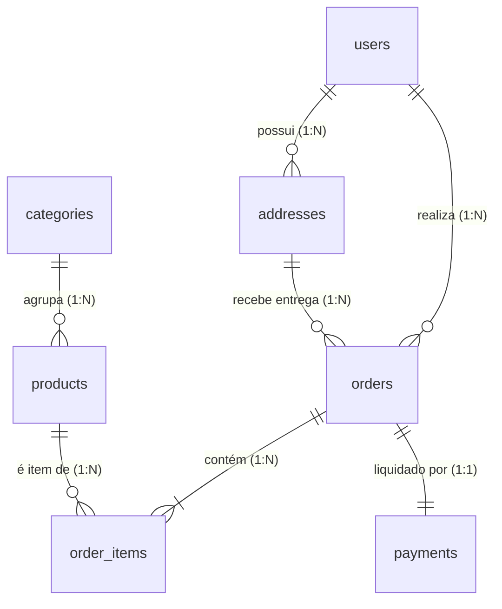

# 🛒 E-Commerce Fullstack (Portfólio de Alta Performance)

Uma plataforma completa de comércio eletrônico desenvolvida com foco em integridade transacional de dados, escalabilidade, checkout transparente (Pix e Cartão de Crédito) e arquitetura moderna em monorepo.

---

## 🚀 Tecnologias Utilizadas

* **Backend**: Node.js, TypeScript, Fastify, Prisma ORM, JWT (Access & Refresh Tokens), Bcrypt.
* **Frontend**: Next.js (App Router), React, TypeScript, Tailwind CSS, Lucide Icons.
* **Banco de Dados**: PostgreSQL (Supabase / Neon) com modelagem relacional estrita (UUIDs, Snapshots imutáveis, restrições e índices de performance).
* **Integrações de Pagamento & Logística**: Mercado Pago SDK/API (Pix dinâmico e Cartão de Crédito em Sandbox), Webhooks e ViaCEP.

---

## 📂 Estrutura do Repositório (Monorepo)

```
E-commerce/
├── docs/                     # Documentação de arquitetura, banco e telas
│   ├── architecture/
│   │   ├── system-architecture.md   # Topologia da solução e segurança
│   │   ├── state-machine.md         # Máquinas de estado de pedidos e pagamentos
│   │   └── user-flows.md            # Diagramas dos fluxos de cliente e admin
│   ├── database/
│   │   ├── schema.sql               # Script DDL completo para PostgreSQL
│   │   ├── erd.md                   # Diagrama ERD visual (Mermaid)
│   │   └── data-dictionary.md       # Dicionário de dados de todas as tabelas
│   └── wireframes/
│       └── screen-specs.md          # Especificação de interfaces e fluxos UX
├── server/                   # Backend API REST (Fastify + Prisma)
├── client/                   # Frontend Web (Next.js + Tailwind)
├── .gitignore
└── README.md
```

---

## 🗄️ Modelo de Dados Relacional (DER)

O banco de dados relacional é estruturado sobre 7 entidades principais, assegurando integridade contábil através do **Price Snapshot Pattern**:



*Consulte a documentação completa do banco de dados em [docs/database/erd.md](docs/database/erd.md) e o script SQL em [docs/database/schema.sql](docs/database/schema.sql).*

---

## 🗺️ Roadmap de Desenvolvimento

- [x] **Etapa 1: Planejamento e Arquitetura de Dados**
  - [x] Definição de escopo do MVP e regras de negócio.
  - [x] Modelagem de dados relacional completa (DER e DDL SQL).
  - [x] Máquina de estados para pedidos e pagamentos com controle transacional de estoque.
  - [x] Mapeamento dos fluxos de navegação e wireframes estruturais de telas.
- [ ] **Etapa 2: Desenvolvimento do Backend (API REST)**
  - [ ] Configuração do servidor Fastify com TypeScript e Prisma ORM.
  - [ ] Autenticação com JWT, refresh tokens e hash de senhas.
  - [ ] CRUD de categorias e produtos com filtros de busca.
  - [ ] Gestão transacional de pedidos e reserva atômica de estoque.
- [ ] **Etapa 3: Integrações de Serviços (Modo Sandbox)**
  - [ ] Checkout Mercado Pago (Pix QR Code e Cartão).
  - [ ] Webhook receptor com garantia de idempotência.
  - [ ] Módulo de cotação de frete e prazos por CEP.
- [ ] **Etapa 4: Desenvolvimento do Frontend**
  - [ ] Catálogo com busca e filtros reativos.
  - [ ] Carrinho de compras responsivo com persistência local.
  - [ ] Checkout transparente com validação de campos em tempo real.
  - [ ] Painel do cliente com histórico de pedidos.
- [ ] **Etapa 5: Painel Administrativo (Backoffice)**
  - [ ] Proteção de rotas administrativas via RBAC (`role = 'admin'`).
  - [ ] Gestão de produtos (preços, estoque e imagens).
  - [ ] Atualização de status e inserção de código de rastreamento.
- [ ] **Etapa 6: Deploy e Documentação Final**
  - [ ] Deploy da API e banco de dados em nuvem.
  - [ ] Deploy do frontend na Vercel.
  - [ ] Guia de execução local e credenciais de teste para recrutadores.
