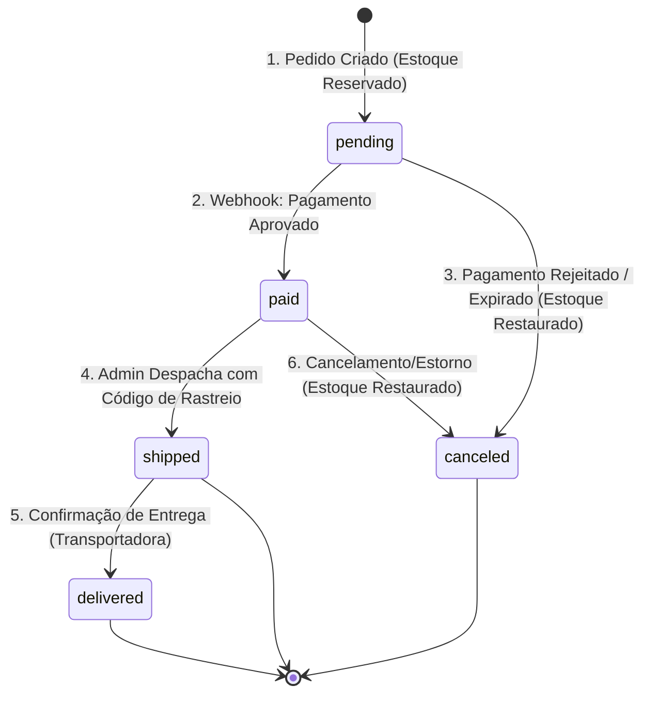
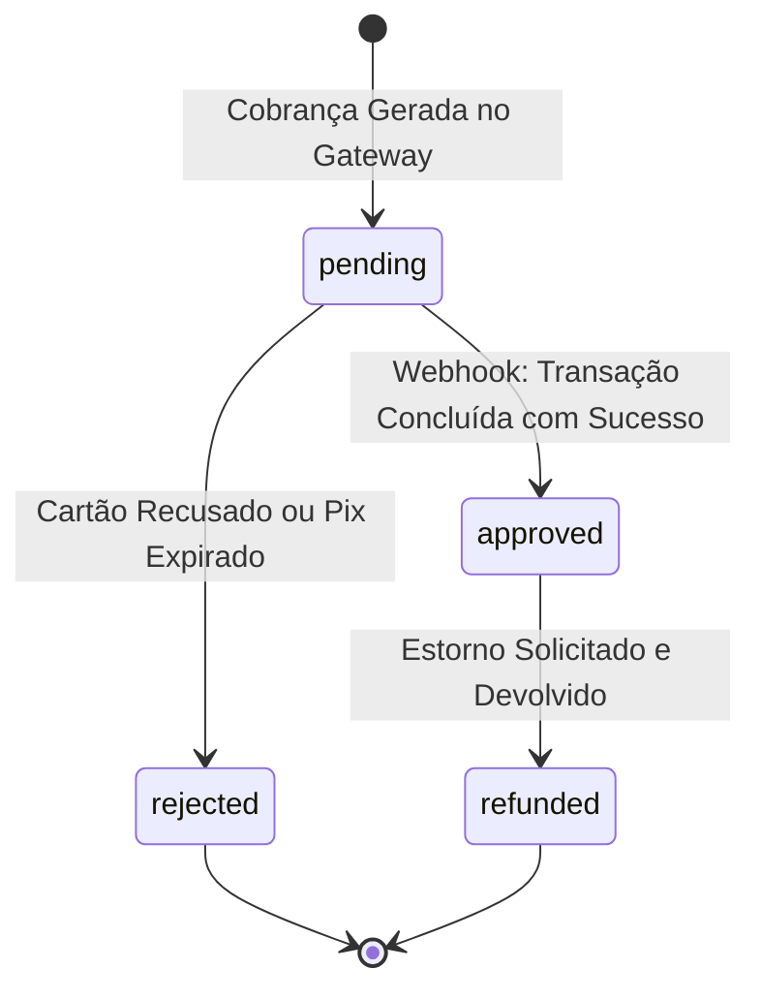

# Máquinas de Estado e Regras de Negócio

Este documento descreve detalhadamente o ciclo de vida dos pedidos e pagamentos, além das garantias de consistência transacional do estoque.

---

## 1. Máquina de Estados: Pedidos (`orders.status`)



### Detalhamento das Transições do Pedido:

| Status Atual | Próximo Status | Gatilho (Trigger) | Ação no Sistema / Estoque |
| :--- | :--- | :--- | :--- |
| `[*] (Inicial)` | `pending` | Cliente clica em "Finalizar Pedido" no checkout. | Inicia transação atômica no banco, valida estoque e decrementa `stock = stock - quantity`. Cria registro em `orders` e `order_items`. |
| `pending` | `paid` | Webhook do gateway notifica aprovação do Pix ou Cartão. | Atualiza `orders.status = 'paid'`, marca data em `payments.paid_at`. Estoque permanece reservado. Notifica cliente. |
| `pending` | `canceled` | Pagamento rejeitado pelo cartão, Pix expirado (após 30 min) ou cancelamento pelo cliente. | Atualiza `orders.status = 'canceled'`, executa transação para **estornar o estoque** (`stock = stock + quantity`). |
| `paid` | `shipped` | Administrador posta a encomenda nos Correios e insere o código de rastreamento no painel. | Atualiza `orders.status = 'shipped'` e armazena `orders.tracking_code`. |
| `shipped` | `delivered` | Cliente confirma recebimento ou status final da transportadora. | Atualiza `orders.status = 'delivered'`. Ciclo de entrega concluído. |
| `paid` | `canceled` | Solicitação de desistência/estorno antes do envio. | Estorna transação no gateway, altera status para `canceled` e restaura o estoque. |

---

## 2. Máquina de Estados: Pagamentos (`payments.status`)



---

## 3. Controle Transacional de Concorrência de Estoque

Para evitar condições de corrida (*Race Conditions* ou *Overselling*) quando dois clientes tentam comprar o último item em estoque simultaneamente, a operação de criação do pedido utiliza **transação com lock pessimista ou checagem atômica**:

### Exemplo em SQL / Prisma:

```sql
-- Executado dentro de uma transação atômica (BEGIN ... COMMIT)
UPDATE products
SET stock = stock - :quantity,
    updated_at = CURRENT_TIMESTAMP
WHERE id = :product_id 
  AND stock >= :quantity 
  AND active = TRUE;

-- Se o número de linhas afetadas (affected rows) for 0:
-- Lançar erro de "Estoque insuficiente" e dar ROLLBACK na transação.
```

### Garantia de Idempotência do Webhook:

O gateway de pagamento pode reenviar o webhook em caso de lentidão de rede. Para evitar processar o mesmo pagamento múltiplas vezes:
1. Ao receber a notificação, consultar `payments` pelo `transaction_id`.
2. Se `payments.status == 'approved'`, retornar HTTP `200 OK` imediatamente sem alterar dados.
3. Se ainda for `pending` e o novo status for `approved`, atualizar `orders` e `payments` em uma única transação atômica.
