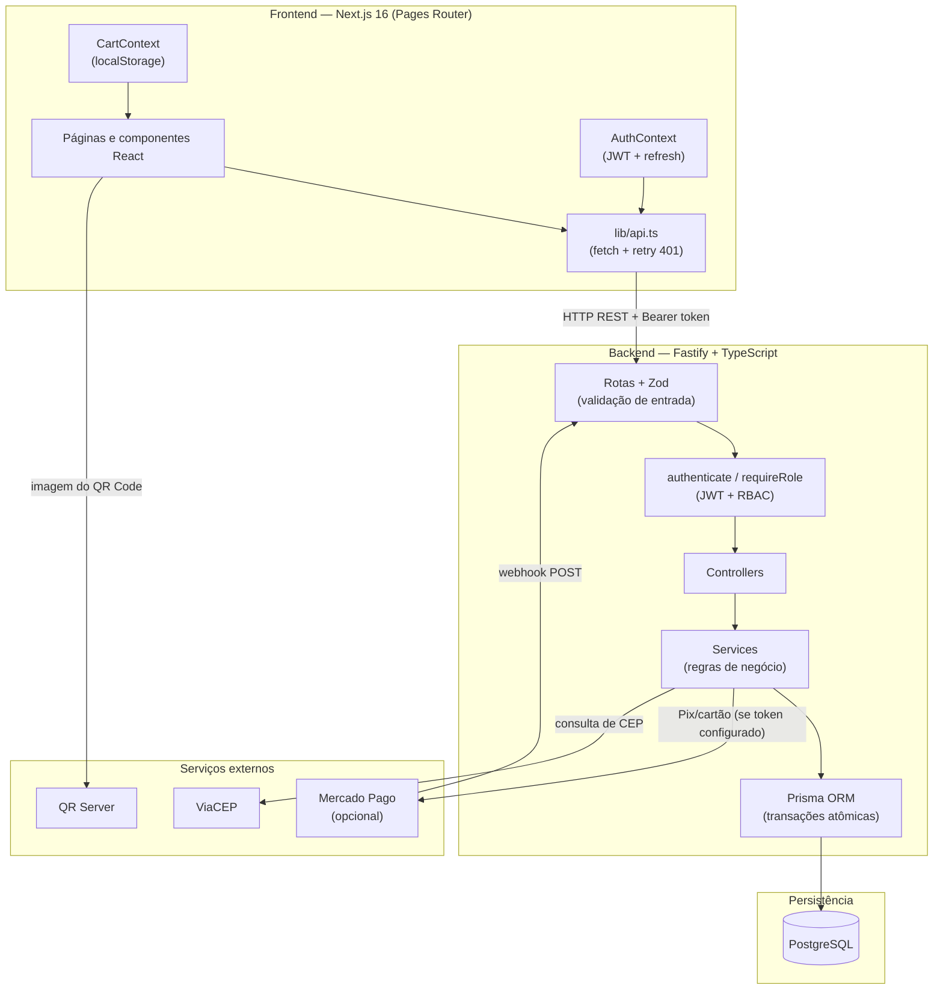
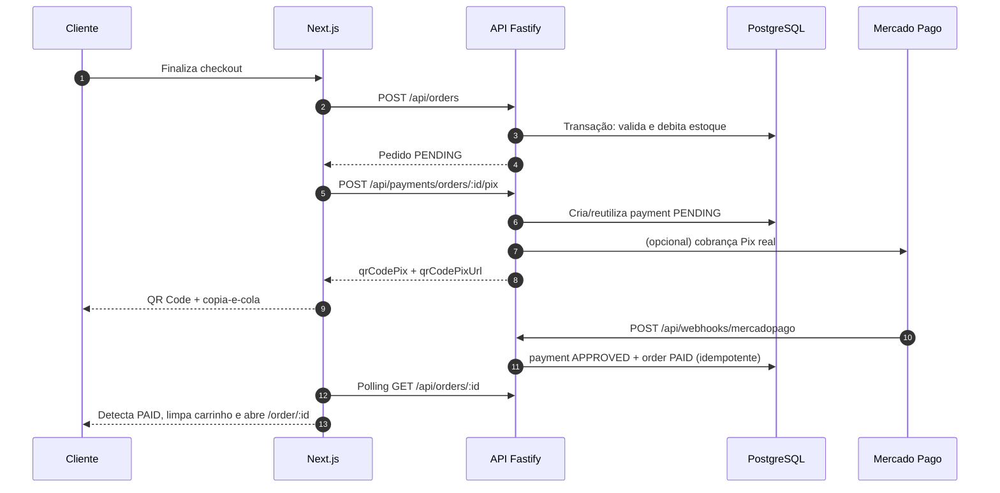

# Arquitetura do Sistema

Este documento descreve a topologia de componentes, o fluxo de dados e as integrações da plataforma **TechStore**.

> Documentação principal: [`README.md`](../../README.md) · Modelo de dados: [`docs/database/erd.md`](../database/erd.md)

---

## 1. Visão geral

A aplicação é um monorepo com frontend e backend desacoplados:

- **Frontend:** Next.js 16 com **Pages Router**, React 19, TypeScript e Tailwind CSS 4.
- **Backend:** API REST stateless em Node.js, Fastify 4, TypeScript, Zod e Prisma ORM.
- **Banco:** PostgreSQL 16.
- **Integrações:** ViaCEP (autocomplete de CEP), Mercado Pago (Pix/cartão, opcional) e QR Server (imagem do QR Code).

O navegador nunca acessa o banco diretamente: todas as regras de negócio passam pela API.

---

## 2. Camadas da API (`/server`)

1. **Routes (`*.routes.ts`)**
   - Definem endpoints, schemas Zod e middlewares de autenticação/RBAC.
   - Registradas em `src/routes.ts`.
2. **Middlewares (`src/middlewares/`)**
   - `authenticate`: valida o JWT e injeta o usuário na requisição.
   - `requireRole('ADMIN')`: restringe rotas administrativas.
3. **Controllers (`*.controller.ts`)**
   - Extraem `params`, `query` e `body`, chamam o service e formatam a resposta HTTP.
4. **Services (`*.service.ts`)**
   - Concentram regras de negócio: credenciais, pagamentos, gateway e validações.
   - Controllers de catálogo/pedidos executam consultas e transações Prisma.
5. **Persistência (`src/lib/prisma.ts`)**
   - Instância única do Prisma Client.
   - Transações relacionais atômicas com `prisma.$transaction`.

Módulos: `auth`, `addresses`, `products`, `categories`, `orders`, `payments`, `shipping`, `admin` e `webhooks`.

---

## 3. Autenticação e segurança

- **Access token:** JWT com expiração curta (15 minutos), enviado em `Authorization: Bearer <token>`.
- **Refresh token:** JWT de 7 dias devolvido no login/registro. O frontend o armazena em `localStorage` e o envia no corpo ou cookie para `POST /api/auth/refresh`.
- **Renovação automática:** `client/lib/api.ts` detecta `401`, chama o refresh e repete a requisição original uma vez.
- **Senhas:** hash com `bcrypt` (custo 10); senhas em texto puro nunca são persistidas.
- **RBAC:**
  - `CLIENT`: catálogo, próprios endereços, próprios pedidos e pagamentos.
  - `ADMIN`: CRUD de produtos/categorias, todos os pedidos, dashboard e mudança de status.
- **Propriedade:** pedidos e endereços são verificados por `userId` antes de qualquer leitura/escrita.
- **Validação:** todos os payloads passam por schemas Zod.

---

## 4. Integrações externas

### 4.1. Mercado Pago (modo simulado por padrão)

O comportamento depende de `MERCADOPAGO_ACCESS_TOKEN`:

**Sem token (padrão):**

- O Pix gera um código copia-e-cola no padrão EMV e uma URL de imagem de QR Code.
- O cartão é sempre aprovado após o envio do formulário.
- O webhook aceita notificações simuladas com `external_reference` e `status` (`approved`/`rejected`).

**Com token:**

- A API cria cobranças Pix reais em `/v1/payments` com `payment_method_id: 'pix'`.
- O webhook consulta o pagamento real usando `data.id`.
- O cartão depende de tokenização no frontend: **o cliente atual ainda envia um token de simulação**, portanto a tokenização real com o SDK/Checkout Bricks do Mercado Pago é uma melhoria futura.

**Webhook:** `POST /api/webhooks/mercadopago` atualiza `payments` e `orders` de forma idempotente (reenvios não duplicam efeitos nem movimentam estoque novamente). A validação de assinatura (`x-signature`) ainda não está implementada.

### 4.2. ViaCEP

Chamada a `https://viacep.com.br/ws/{cep}/json/` para preencher logradouro, bairro, cidade e UF no checkout.

### 4.3. Frete

O cálculo é **simulado** por regras internas que combinam UF de destino, peso e dimensões dos produtos. Retorna opções PAC e SEDEX com prazo e valor. Não há integração com transportadora real.

---

## 5. Fluxo de checkout e pagamento

### Regras de estoque

- A criação do pedido roda em transação: valida disponibilidade e debita o estoque atomicamente.
- Webhook `rejected`/`cancelled` e cancelamento pelo admin repõem o estoque.
- Produtos usam soft delete (`active = false`) para preservar pedidos históricos.

---

## 6. Decisões de arquitetura

| Decisão | justificativa |
| :--- | :--- |
| API REST separada do Next.js | Permite consumir a mesma API por outros clientes e simplifica o deploy independente. |
| Pages Router | Estrutura estável e direta para o escopo do projeto; todas as rotas são em `pages/`. |
| Mercado Pago simulado por padrão | Permite que recrutadores testem o fluxo completo sem credenciais de gateway. |
| Snapshot de produto no pedido | Preserva nome e preço históricos mesmo após alterações no catálogo. |
| `prisma db push` no deploy | Agiliza o provisionamento; migrations versionadas são uma melhoria futura. |
| Refresh token em `localStorage` | Simplifica o SPA; cookie `HttpOnly` + CSRF é o próximo passo de segurança. |
