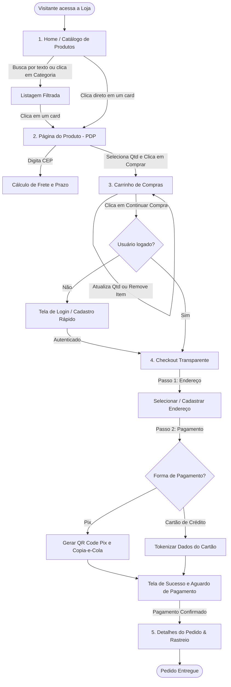
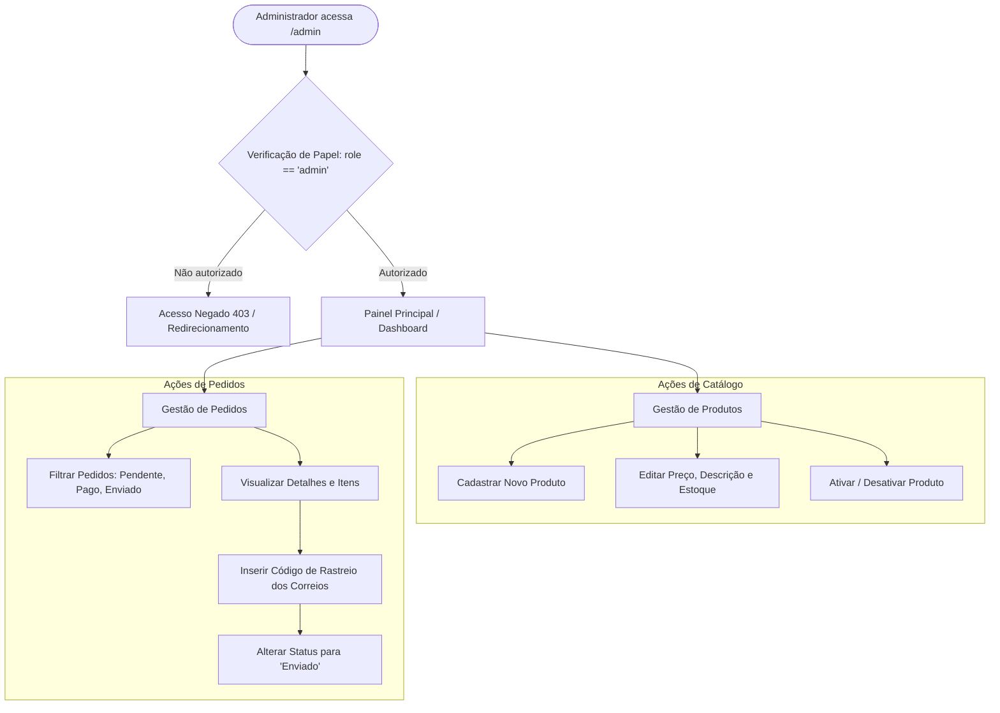

# Fluxos de Usuário (User Flows)

Este documento mapeia as jornadas e fluxos de navegação dos usuários nas visões de **Cliente** e de **Administrador**.

---

## 1. Fluxo Completo do Cliente (Jornada de Compra)

---

## 2. Fluxo do Administrador (Backoffice Operacional)

