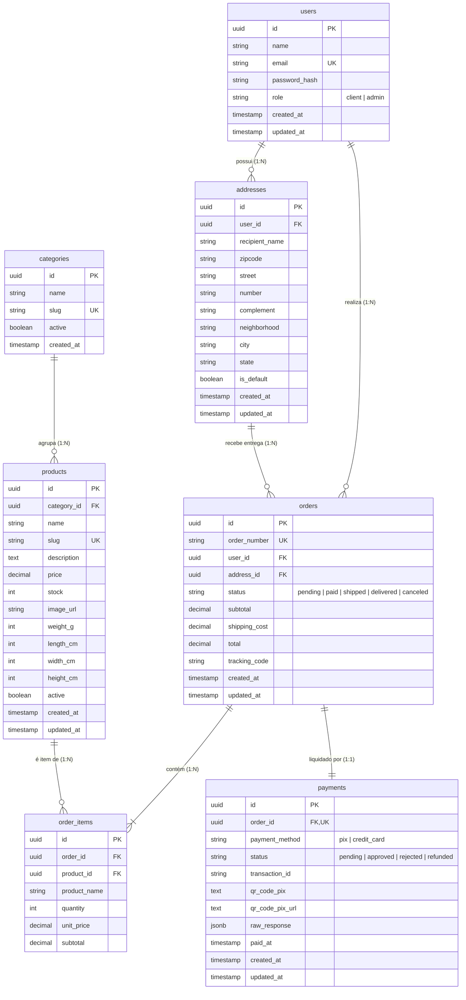

# Diagrama de Entidade-Relacionamento (DER)

Este documento detalha o modelo conceitual e lógico do banco de dados relacional (PostgreSQL) do projeto de E-commerce.

---

## 1. Diagrama Visual (Mermaid)

---

## 2. Cardinalidades e Justificativas de Relacionamento

| Relacionamento | Tipo | Descrição e Justificativa de Negócio |
| :--- | :---: | :--- |
| `users` $\rightarrow$ `addresses` | **1 : N** | Um usuário pode ter múltiplos endereços salvos (ex: Casa, Trabalho). Apenas um deles pode ser marcado como padrão (`is_default = true`). |
| `users` $\rightarrow$ `orders` | **1 : N** | Um usuário pode realizar vários pedidos ao longo do tempo. O histórico de compras fica associado ao `user_id`. |
| `addresses` $\rightarrow$ `orders` | **1 : N** | Um endereço cadastrado pode ser reutilizado em diferentes pedidos. |
| `categories` $\rightarrow$ `products` | **1 : N** | Cada produto pertence a uma categoria principal para facilitar a taxonomia, buscas e filtragem no catálogo. |
| `orders` $\rightarrow$ `order_items` | **1 : N** | Um pedido contém 1 ou mais itens comprados. A tabela `order_items` atua como relação N:N resolvida entre `orders` e `products`. |
| `products` $\rightarrow$ `order_items` | **1 : N** | Um produto pode aparecer em diversos pedidos de clientes distintos. |
| `orders` $\rightarrow$ `payments` | **1 : 1** | No escopo do MVP, cada pedido possui uma única tentativa/registro de pagamento ativa vinculada à transação do gateway. |

---

## 3. Regras de Integridade Referencial

* **`ON DELETE CASCADE`**:
  * `addresses` $\rightarrow$ deletado se o `user` for deletado.
  * `order_items` $\rightarrow$ deletados automaticamente se o `order` for deletado (limpeza de integridade de pedido).
  * `payments` $\rightarrow$ deletado se o `order` for deletado.
* **`ON DELETE RESTRICT`**:
  * `products` $\rightarrow$ **proibido deletar** um produto se ele já constar em algum `order_items`. Isso impede a corrupção do histórico contábil de compras. Se o administrador não quiser mais vender o produto, ele deve apenas desativá-lo (`active = false`).
  * `users` e `addresses` $\rightarrow$ **proibido deletar** caso possuam vínculos com pedidos já efetuados (`orders`).

